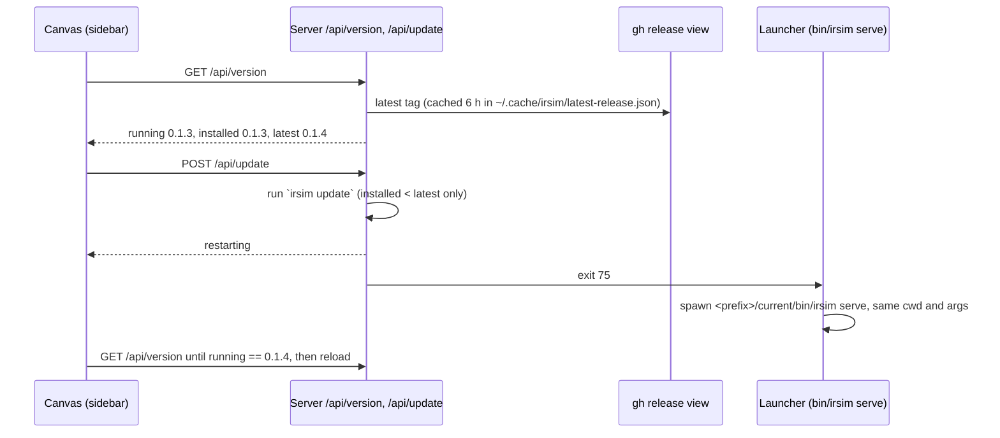

# 02 · update notice in the canvas

## Goal

The canvas shows when a newer irsim release exists and updates and restarts itself with one click, as Plannotator's "Update now" does.

## Approach

- `bin/irsim serve` passes `IRSIM_VERSION`, `IRSIM_LAUNCHER` and `IRSIM_PREFIX` (empty for a source checkout) to the server.
- `GET /api/version` answers `{ running, installed, latest, releaseUrl, canUpdate }`. `installed` is the version `<prefix>/current` points at, so a canvas still running an older version after another project updated says "restart", not "update".
- `POST /api/update` runs the launcher's `update` when `installed < latest`, answers `restarting`, then exits with code 75.
- The launcher restarts on exit code 75 by spawning the `current` launcher's `serve` with the same args and cwd, and keeps forwarding signals and the exit code. The port is the same, because `canvasPort(root)` is derived from the project.
- `UpdateNotice` sits at the bottom of the page sidebar and on the page index. Dismissed per version in `localStorage`.

## Decisions

- Read the latest release with `gh`, not `fetch`: `kafbit/irsim` is private, so the unauthenticated API answers 404. This is what `irsim update` does already.
- No `gh`, no login, or a source checkout: no notice. A failed check is cached for 1 h, so a missing `gh` is not run on every request.
- One cache file in `~/.cache/irsim` for every running server, so ten canvases make one `gh` call per 6 h.
- One click updates and restarts. The rejected alternative is Plannotator's "copy the command": it still needs a terminal and a restart of every canvas.
- The failed state shows the error and a copy button for `irsim update`, so the slow path stays available.
- `irsim update` keeps a version directory while a live server runs from it: the launcher writes `<prefix>/<version>/.pids/<pid>`, and the cleanup checks each pid with `process.kill(pid, 0)`. Today an update in project A deletes the directory a server in project B runs from.

## Milestones

1. Board `UpdateNotice` in `design/` with every state as a `data-props` variant, checked, confirmed by the user.
2. Server: version check, update route, launcher restart, pid-guarded cleanup, tests.
3. Canvas: `UpdateNotice` in the sidebar and page index, matched against the board.

## Risks

- Servers on 0.1.2 and older have no restart code, so the first move to the release with this feature is still `irsim update` plus a manual restart.
- `irsim update` runs `init --refresh-block` in the project, so an update from the canvas can change `AGENTS.md` and `CLAUDE.md` there. This is the current `irsim update` behaviour.
- A restart reloads the page, so an open comment draft is lost. The camera position is kept by `view-storage`.
- The restart path only exists in a release install, so it is tested with a fake release prefix in a temp dir, not with a real download.
