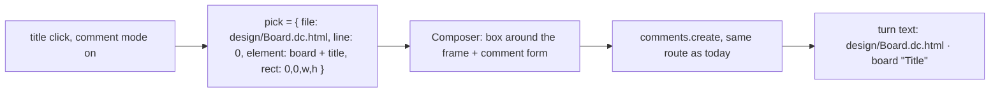

# 2026-11-12 · comment on a whole board from its frame title

## Goal

With comment mode on (`C`), clicking a frame's title on the page canvas adds a comment on the whole board.

## Approach

## Decisions

- `line: 0` and `element.tag: 'board'` mark a whole-board comment. No schema or route change, old comments keep working. Line 1 would send Claude to the doctype.
- In comment mode the title shows a crosshair cursor and, on hover, the frame gets the same 2px `--pick` outline as an element hover.
- A title click in comment mode no longer selects the board. With comment mode off nothing changes.
- The single-board view (`alone=1`) has no frame title and is out of scope.
- The pin sits at the top-end corner of the frame like any other comment.
- Place text (`file:line`) prints `file` only when `line` is 0, in the turn text, the comment card, the comment form and the plugin tool output.

## Milestones

1. Board change in `design/CanvasFrame.dc.html` and `design/CanvasFrameCommenting.dc.html`, checked, then the user confirms.
2. Code and tests.
3. Compare the running canvas with the board in screenshots.
4. Typecheck, lint, affected tests.

## Risks

- A tall board puts the comment panel off-screen. `placePanel` clamps it into the viewport, to be seen in the screenshots.
- The turn text is shared by the plugin and the CLI, so both change together.
